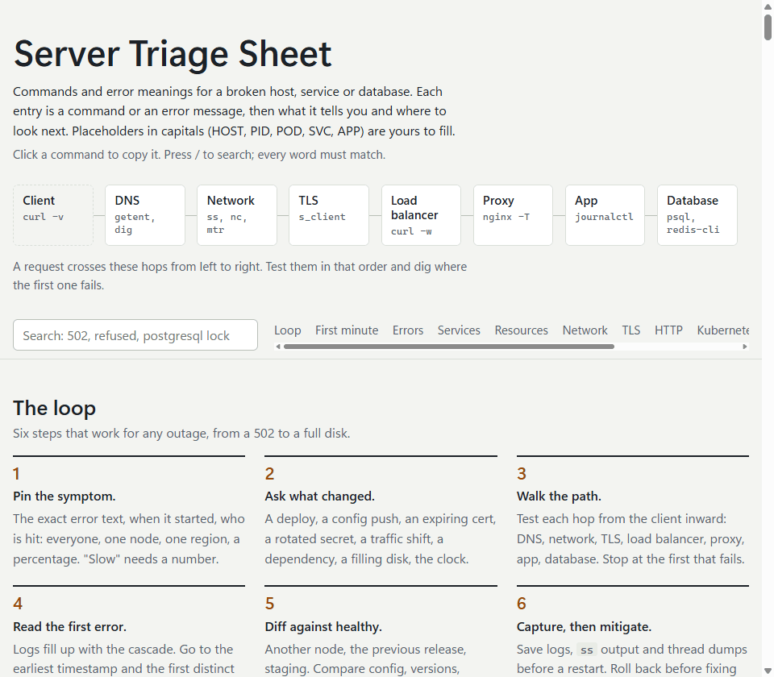
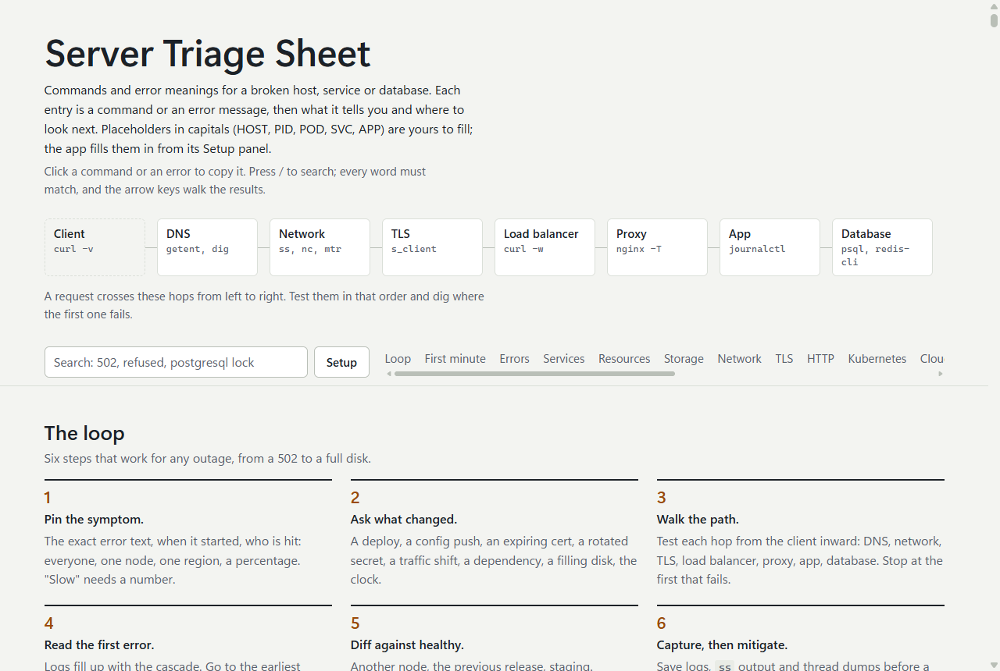
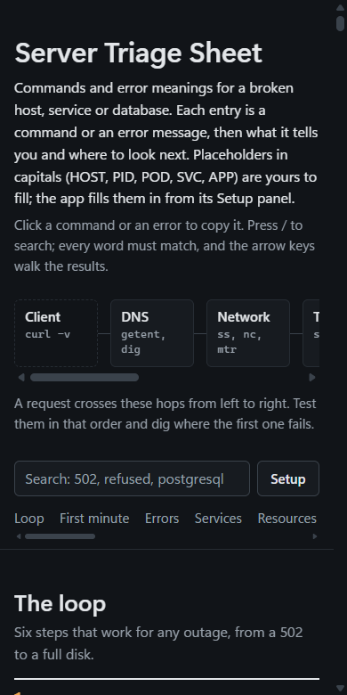

# Server Triage Sheet

A one-page sheet for debugging a broken Linux host, service or database. Each entry is one command or one error message, then what it tells you and where to look next. It works offline and installs as an app.



**[Open the sheet](https://makavli.github.io/server-triage/)** · [Download it](https://github.com/makavli/server-triage/releases/latest) · [Read it as Markdown](CHEATSHEET.md)

## What's in it

Twenty sections, in the order you debug:

- **Where to start:** the triage loop, the first minute on a host, and an error decoder.
- **The host:** services and logs; CPU, memory, disk and files; storage and filesystems.
- **The way in:** DNS, ports and packets; TLS and certificates; HTTP, proxies and load balancers; containers and Kubernetes; AWS, Google Cloud and Azure.
- **The app:** JVM, Node.js, Python and Go runtimes; Kafka and RabbitMQ.
- **The data:** PostgreSQL, MySQL and MariaDB, SQL Server, SQLite, Redis and Valkey, MongoDB, and Elasticsearch and OpenSearch.

Written for Linux with systemd (Ubuntu 22.04 and later, RHEL 8 and 9), OpenSSL 3, Kubernetes 1.30 and later, PostgreSQL 14 to 18, MySQL 8.0 and 8.4, MariaDB 10.11 and 11.4, SQL Server 2019 and 2022, SQLite 3.37 and later, Redis 7 and Valkey 8, MongoDB 7 and 8, Kafka 3.7 and later (KRaft), RabbitMQ 4, Elasticsearch 8 and OpenSearch 2, JDK 17 and later, Node.js 20 and later, Python 3.9 and later, Go 1.22 and later, and the current AWS, Google Cloud and Azure CLIs. A tag marks a command that needs a newer version.

Commands that read are safe on a live host. A command that changes state carries a **Changes state** tag, and one that can lose data carries **Can lose data**. Other tags name the distribution (Debian and Ubuntu, or the RHEL family) or the oldest version a command needs, such as PostgreSQL 16+.

## Use it

- **Copy:** click a command, or focus it and press Enter. Words in capitals (HOST, PID, POD, SVC, APP) are placeholders.
- **Fill in your values:** open **Setup** and type your host, pod or database once. Every command then shows and copies it in place of the placeholder.
- **Search:** press `/` and type. Every word must match, in any order, and common synonyms count: `oom` finds "out of memory", `cert` finds "certificate". Matches are highlighted. The arrow keys or `j` and `k` walk the results; Esc goes back to the search box.
- **Filter:** in **Setup**, hide the commands that change state, keep one distribution, or give your versions (PostgreSQL 15, say) to hide what needs a newer one.
- **Pin and annotate:** each entry has a pin, a note and a link. Pinned entries gather at the top. The link opens the sheet on that one entry, for a ticket or a chat.
- **Add your own:** **Add an entry** in **Setup** keeps your own commands and errors next to the sheet's, searchable like the rest.
- **Follow the path:** the hops at the top (Client, DNS, Network, TLS and on to Database) are the order to test in. Each one links to its section. Dig where the first one fails.

<p>
  <picture>
    <source media="(prefers-color-scheme: dark)" srcset="docs/screenshot-dark.png">
    
  </picture>
  
</p>

## Get it

- **Browser:** open [makavli.github.io/server-triage](https://makavli.github.io/server-triage/). After the first visit it works offline.
- **Windows app:** open that page in Edge or Chrome and choose **Install app**. It gets its own window and a Start menu entry, and it works without a network.
- **One file:** download `index.html` from the [latest release](https://github.com/makavli/server-triage/releases/latest) and open it in any browser. Search and copy work. Install and offline need https, so they don't work from disk.
- **Terminal:** [CHEATSHEET.md](CHEATSHEET.md) is the same content as plain Markdown, for `less` or `grep`.

**Privacy:** the page loads only its own files. It has no analytics or web fonts, and it doesn't store your searches. Your values, pins, notes, entries and filters stay in this browser, in its local database; nothing is sent anywhere. **Export** in **Setup** saves them as a JSON file, **Import** merges one back on another device, and **Delete my data** clears them. Its [Content-Security-Policy](tools/build.mjs) starts with `default-src 'none'`.

## Contribute

The page is built from `CHEATSHEET.md`, so a fix to the sheet is a fix to the app.

1. Edit `CHEATSHEET.md`. An entry is a ` ```sh `, ` ```sql `, ` ```js ` (the MongoDB shell) or ` ```text ` block, followed by one paragraph. Use `text` for an error message or a state. Run each new command on a real host first.
   - Tags go after the language: ` ```sh changes ` for a command that changes state, `danger` for one that can lose data, `deb` or `rhel` for one distribution, and a version such as `pg16+` or `k8s1.30+`. The build lists the valid ones when it meets a wrong one.
   - A placeholder is a word in capitals listed in `PLACEHOLDERS` in `tools/build.mjs`. Add a new one there, with its hint, and it gets a field in **Setup**.
   - Each entry gets a link from its section and its code, so the same code twice in one section fails the build.
2. Run `npm run bump <version>` and write the `CHANGELOG.md` entry. Every merge into main is a release.
3. Run `npm run build`, then `npm run check`. The check needs Node 22+, and it also runs a headless Chrome or Edge test when one is installed.
4. Open a pull request. The checks run on Linux and Windows. While they are red, an issue tracks them.

`npm run icons` redraws the icons. `npm run shots` retakes these pictures headless; the animation also needs ffmpeg.

## Licence

[MIT](LICENSE). To report a security problem privately, see [SECURITY.md](SECURITY.md).
